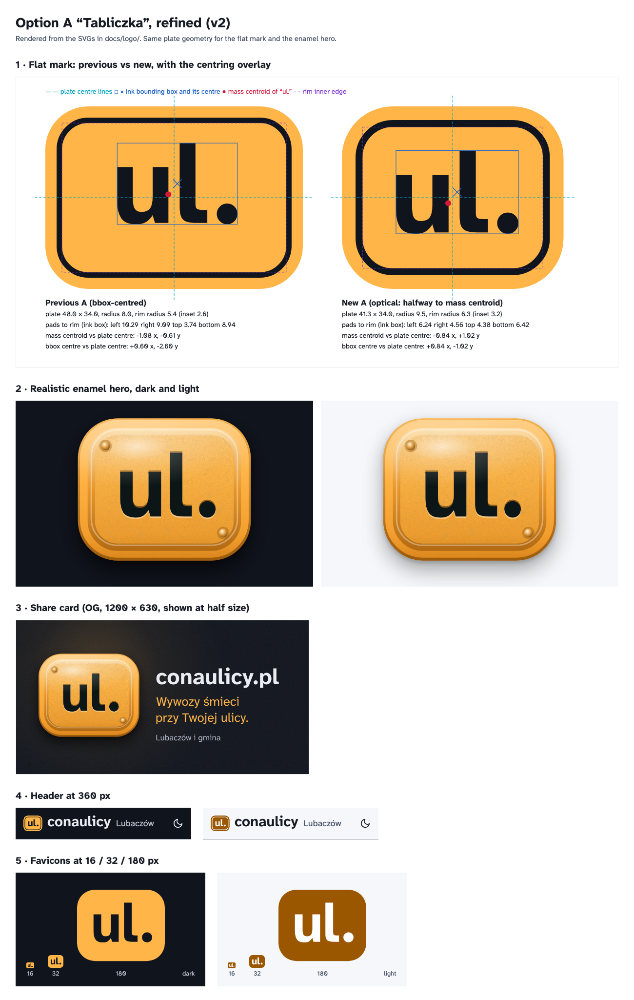
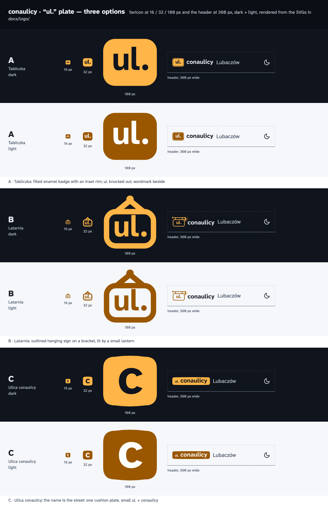

# “ul.” plate logo

Jakub picked **A “Tabliczka”** (task 20), refined in task 22 (below). The **flat** version shipped in task 23 (header, icons, manifest, OG card, PDF); usage rules are in [`docs/brand.md`](../brand.md). The enamel version stays here as backlog.

## A “Tabliczka”, refined (task 22)

`comparison-sheet-a-v2.png`, rendered from the SVGs here, shows:
- the new flat A against the previous one, with the centring overlay;
- the enamel hero on dark and light;
- the OG card;
- the header at 360 px, dark and light;
- the favicons at 16, 32 and 180 px.

**One plate, two tiers.** The flat mark and the realistic hero share the same geometry (`source/make_logo_a.py`, `plate_geometry`):

- **Plate:** 41.3 × 34, corner radius 9.5.
- **Rim:** inset 3.2 and 1.3 wide. Its radius is 6.3 = 9.5 − 3.2, so the two curves are concentric.
- **Padding:** 5.4 from the rim to the ink box on all four sides, before the optical shift.

**Optical centring.** "ul." is placed halfway between bounding-box centring and mass centring. The mass centroid is computed from the outlines (area-weighted, fontTools `StatisticsPen`). The light period and the thin ascender of "l" otherwise make the word look too far left and too low. The result is a shift of 0.84 right and 1.02 up.
- **Pads to the rim, by ink box:** left 6.24, right 4.56, top 4.38, bottom 6.42. They look equal because the right side is only a period and the top only one stem.
- **Previous A:** left 10.29, right 9.09, top 3.74, bottom 8.94, so it sat visibly high.

See `debug/a-centring-overlay.png`, which shows plate centre lines, ink box and centre, mass centroid and rim edge. The numbers are in `debug/a-measure.json`.

**Kerning.** u|l −14 units, l|. +6, set by eye at 400 %.

**Header.** The plate is 1.6 × the wordmark's cap height: "conaulicy" at 31.8 on a 34-high plate. In the 360 px header the whole mark is 32 px tall, next to "Lubaczów".
- **Alignment:** the wordmark sits on the **baseline of "ul."** on the plate. Its x-height centre then lands 1.4 units above the plate centre, which reads as centred, because lowercase sits optically low.
- **Size:** the mark is much larger than before. The old plate was 28 px tall with a 20 px wordmark.

**Favicons.** These are separate designs, pixel-snapped: plate edges and baselines on whole pixels, x-height a whole number of pixels.
- **`a-favicon-16.svg`:** 16-px grid, x-height 5 px.
- **`a-favicon.svg`:** 32-px grid, x-height 10 px. It switches colour with `prefers-color-scheme`.
- **PNGs:** `a-icon-16/32/180/512.png` and `a-icon-maskable-512.png` (mark inside the 80 % safe circle).

**Realistic hero** (`a-hero-dark.svg`, `a-hero-light.svg`). Enamelled steel, same geometry, pure SVG: gradients and filters, no raster.
- **Surface:** a domed amber field (`#FFB547` base), a soft oval specular highlight, and a rolled rim lit from above.
- **Letters:** dark enamel `#0F1419`, debossed with a hairline highlight below. Contrast is 10.5 : 1 against `#FFB547`, and at least 6.5 : 1 anywhere on the dome (`#D9851C` at its darkest), so AA holds everywhere.
- **Details:** two rivets on the diagonal, fine `feTurbulence` grain with the faintest wear, and a soft shadow on the wall.
- **Uses:**
  - `a-og-enamel.svg` / `.png`: share card with "conaulicy.pl", "Wywozy śmieci przy Twojej ulicy." and "Lubaczów i gmina", all outlined (backlog; the shipped card is the flat `og-1200x630.*`, task 23).
  - `a-hero-*.png`: landing hero, 2×.
  - `a-pdf-corner.svg` / `.png`: large, on white, for the PDF corner.

**Files.**
- `a-logo-{dark,light,mono}.svg`: lockup.
- `a-mark-{dark,light,mono}.svg`: plate only.
- The previous A is kept in `previous/` for comparison.

**Rebuild.** Needs `fonttools` and `uharfbuzz`:
1. `python docs/logo/source/make_logo_a.py <out>`
2. `npx svgo@4.1.0 --config docs/logo/source/svgo.config.mjs -f <out> -o <opt>`
3. `node docs/logo/source/render_a.mjs <opt> <out>/a-centring-overlay.svg <png out>`

## The three original options (task 20)

`comparison-sheet.png`: per variant, the favicon at 16, 32 and 180 px and the header at 360 px wide, dark and light. Rendered with Playwright from the SVGs in this folder.

## The three ideas

| | Name | Idea | Mark vs. name | Favicon |
|---|---|---|---|---|
| **A** | Tabliczka | A compact enamel plate: filled amber, with a fine inset rim like pressed enamel; “ul.” knocked out. Calm and solid. | The plate is a badge; “conaulicy” sits beside it in the text colour. | The plate alone, no rim: “ul.” as large as it gets. |
| **B** | Latarnia | A hanging sign: outlined plate on a wall bracket, lit by a small street lantern with a warm glow (the palette is called Latarnia). The most illustrative. | The sign carries “ul.” in amber; “conaulicy” beside it. | The sign alone, hanging from a hook on a V cord; no bracket or lamp at 16 px. |
| **C** | Ulica conaulicy | The name is the street: one wide plate with gently bowed edges reads “ul. conaulicy”, small “ul.” and the name sharing a baseline. The boldest, and the name and the mark are one. | Everything is on the plate. | The plate's first letter, “c”, on a bowed tile. |

All three avoid the blue-and-white MSI street sign, the city's herb and any official symbol, and use only the Latarnia amber: `#FFB547` on dark, `#9A5700` on light.

## Files (per variant `a`, `b`, `c`)

| File | What |
|---|---|
| `{v}-logo-dark.svg` | Full mark (plate + conaulicy) for the dark theme |
| `{v}-logo-light.svg` | Full mark for the light theme |
| `{v}-logo-mono.svg` | One colour, `currentColor` (B drops the lantern glow) |
| `{v}-favicon.svg` | Simplified 32×32 favicon, legible at 16 px; switches amber with `prefers-color-scheme` |
| `{v}-icon-32.png` | PNG fallback, transparent |
| `{v}-icon-180.png` | Apple touch icon, on the night tile |
| `{v}-icon-512.png` | PWA icon, on the night tile |
| `{v}-icon-maskable-512.png` | Maskable PWA icon: full-bleed tile, mark inside the 80 % safe circle |

## How they are made

- Letters are Atkinson Hyperlegible Next **700**, shaped with HarfBuzz (kerning on), then optically kerned by hand (“u–l” closed up, “l–.” opened, “c–o” opened, “l–i” and “c–y” tightened) and **outlined to paths**. No font is embedded.
- Knock-outs use an SVG mask, so the plate's text shows whatever is behind it, in every theme and in `currentColor`.
- Paths only, no raster, no `<text>`. Optimised with SVGO 4.1.0 (`source/svgo.config.mjs`: `inlineStyles` off so the favicon's colour-scheme media query survives). Logos are 2.8–3.4 KB, favicons 0.7–1 KB.
- `source/make_logos.py` regenerates the task-20 SVGs, A in its previous form included, so write to a temporary folder (needs `fonttools` and `uharfbuzz`), then:
  `npx svgo@4.1.0 --config docs/logo/source/svgo.config.mjs -f <out> -o <opt>`

## Shipped (task 23)

`node docs/logo/source/ship_a.mjs` builds the web files from the SVGs here:
- `web/app/favicon.ico` (16 + 32 from the two favicon drawings);
- `web/app/icon.svg`, `web/app/apple-icon.png`;
- `web/public/icon-{192,512}.png`, `icon-maskable-512.png`;
- `web/public/og.png` and `og-1200x630.png`: the flat plate on white, from `og_flat("light")` in `make_logo_a.py` (task 26, light-only site). The task-23 night card is `a-og-dark.*`.
- `web/app/icon.svg`: `a-favicon.svg` with its light colours and no colour-scheme query.

The header and PDF paths live in `web/lib/logo.ts`, copied from `a-logo-mono.svg`.
